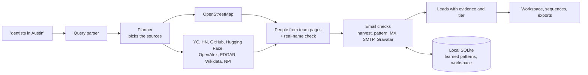

<div align="center">

# OpenLeads

**Describe a customer. Get the people, with every email labeled by how we know it.**

OpenLeads searches free public sources for the businesses and people you describe,
finds their work emails, and marks each one *found*, *pattern* or *guessed*. Then it
works them like Apollo does: lists, ICP scoring, sequences, tasks and a deal pipeline.
It runs on your machine, with no API keys and nothing to pay.

[](https://pypi.org/project/openleads/)
[](https://www.npmjs.com/package/openleads)
[](https://www.python.org/)
[](https://github.com/Samyrrrrrr990/openleads/actions/workflows/ci.yml)
[](./BENCHMARK.md)
[](./LICENSE)

[Website](https://samyrrrrrr990.github.io/openleads/) &nbsp;|&nbsp;
[Docs](https://samyrrrrrr990.github.io/openleads/docs/) &nbsp;|&nbsp;
[Live benchmark](./BENCHMARK.md) &nbsp;|&nbsp;
[Changelog](./CHANGELOG.md)

</div>

```bash
pipx install "openleads[all]"          # or: pip install "openleads[all]", or: npx openleads
openleads find "dentists in Austin"    # ten leads, every email labeled
openleads web                          # the workspace at http://127.0.0.1:8787
```


<sub>The local dashboard on the demo workspace (`openleads demo`, invented data).</sub>

## Every email says how we know it

Most free finders call a `first.last@` guess "valid". OpenLeads labels each address
with where it came from, then decides separately whether it is safe to send:

| Evidence | Meaning |
|---|---|
| **found** | Published on the company's site, in a public commit or security.txt, or confirmed by the mail server |
| **pattern** | Built from an address format already seen at that company |
| **guessed** | The most common format for that name. Nothing confirms it, and the label says so |

| Tier | What happens |
|---|---|
| **safe** | Sent by default |
| **risky** | Held for your review unless you opt in |
| **bad** | Dropped (no mail server, disposable, or it bounced) |

Seven checks decide the tier, and most of them work without port 25, which home
internet providers block: two DNS-over-HTTPS resolvers that must agree on the mail
server, SPF and DMARC, disposable/role/free-mail lists, Gravatar, published
addresses, learned company patterns, and SMTP with catch-all detection when port 25
is open. [How the scoring works](./docs/deliverability.md).

## Measured against live data every night

Unit tests can't tell you whether "dentists in Austin" returns dentists, so a GitHub
Action runs the same real searches against the live sources every night, asks for ten
leads each, and commits what came back to [BENCHMARK.md](./BENCHMARK.md), empty
nights included. Run it yourself with `openleads bench`.

## What you can search

One sentence fans out across the sources that fit it. You never have to pick one,
but `-s name` pins a source.

| Ask for | Searched | Example |
|---|---|---|
| Local businesses, any city | OpenStreetMap (Overpass and Nominatim) | `"accountants in Toronto"` |
| Startup founders, companies hiring | Y Combinator, Hacker News | `"AI startup founders"` |
| Companies by industry | Wikidata, SEC EDGAR | `"fintech companies"` |
| Developers | GitHub | `"rust developers in Berlin"` |
| ML builders | Hugging Face | `"ML engineers"` |
| Researchers | OpenAlex | `"machine learning researchers"` |
| Everyone at one company | the company's own site | `"emails at stripe.com"` |
| US healthcare providers | NPI Registry | `"pediatricians"` |

Companies are turned into named people from their team and about pages. When a
search comes back short, OpenLeads says which source failed or ran out of time and
what to try next. Need a source we don't have? A source is
[one Python file](./docs/sources.md).

## Work your leads

Everything you find lands in a local workspace: the same data in the dashboard, the
terminal and your AI assistant.

<table>
<tr>
<td width="50%"></td>
<td width="50%"></td>
</tr>
<tr>
<td><b>Home.</b> What is due today, how outreach is going, and the strongest leads you haven't contacted.</td>
<td><b>Sequences.</b> Email, call, LinkedIn and task steps with A/B variants and same-thread follow-ups. People leave when they reply, bounce or unsubscribe.</td>
</tr>
<tr>
<td></td>
<td></td>
</tr>
<tr>
<td><b>Deals.</b> A drag-and-drop pipeline with a weighted forecast. Winning a deal makes the contact a customer.</td>
<td><b>Everything else.</b> People and companies with Apollo-style filters, lists, ICP fit from A to D, a task queue, templates, CSV import, duplicate merge and a ⌘K palette.</td>
</tr>
</table>

```bash
openleads people --fit A --never-contacted                 # best untouched leads
openleads lists add "Q4 dentists" --where dental
openleads seq enroll "Q4 outbound" --list "Q4 dentists"
openleads tasks --bucket today
openleads import apollo-export.csv --list "Imported"
```

[Workspace guide](./docs/workspace.md) &nbsp;|&nbsp; [Sequences guide](./docs/sequences.md) &nbsp;|&nbsp; [Moving from Apollo](./docs/from-apollo.md)

## Use it from Python

```python
import openleads

leads = openleads.find("gyms in Sydney", count=20)
for lead in leads:
    print(lead.email, lead.evidence, lead.tier)
leads.write("gyms.csv")            # .csv, .json or .jsonl
print(leads.report.summary())      # which sources ran, what failed, why it stopped
```

[Python API](./docs/python-api.md)

## Use it from Claude, Cursor or Claude Code

OpenLeads is an [MCP server](./docs/mcp.md). Your assistant can find and verify leads
mid-conversation, and work your lists, tasks and sequences:

```bash
claude mcp add openleads -- openleads mcp
```

```json
{ "mcpServers": { "openleads": { "command": "openleads", "args": ["mcp"] } } }
```

> *"Find 10 law firms in London with emails we can actually send to, save them to a list called London law, and give me a call task for each partner."*

The assistant can search and edit your workspace, but it never sends email itself.

## Automate it

Draw a search as a workflow in the dashboard, or save it as a recipe and put it on a
schedule. Sends stay inside your daily cap, warmup ramp and business hours, and stop
for anyone who replies.

```bash
openleads recipe add miami "marketing agencies in Miami" --every "weekdays 9am" --send
openleads watch add new-dentists "dentists in Austin"     # tell me only about new matches
openleads schedule on      # one agent: launchd, cron or Windows Task Scheduler
openleads runs             # what ran, what it found, what failed
```

[Workflows](./docs/workflows.md) &nbsp;|&nbsp; [Timed runs](./docs/timed-runs.md). Exports go to CSV, Google
Sheets, Notion, Airtable, HubSpot or any webhook. There is also a GitHub Action:

```yaml
- uses: Samyrrrrrr990/openleads@v5.1.1
  with: { query: "marketing agencies in Miami", count: 50 }
```

## Install

```bash
pipx install "openleads[all]"     # recommended
pip install openleads             # minimal: the standard-library engine and CLI
npx openleads                     # Node: sets up a private Python environment on first run
```

```bash
openleads doctor    # checks your setup: DNS, port 25, mailbox
openleads demo      # the dashboard on an invented workspace
openleads           # chat: type what you want
```

Python 3.8 or newer on macOS, Linux or Windows. Full walkthrough:
[quickstart](./docs/quickstart.md).

## Commands

```bash
# find
openleads find "50 fintech founders, verified only" -o leads.csv
openleads find "accountants in Toronto" --explain     # the plan, each source's status, hints
openleads company stripe.com                           # tech stack, socials, phones, people
openleads enrich my-list.csv                           # your names and companies, emails labeled
openleads verify ada@acme.io

# reach out (a dry run unless you add --live)
openleads write "rust developers in Berlin"
openleads run "rust developers in Berlin"

# the workspace
openleads people | companies | lists | seq | tasks | deals
openleads import | export | dedupe | stats | backup

# set up and automate
openleads init | config | doctor | web | mcp | bench
openleads recipe | watch | schedule | runs
```

`openleads --help` lists every command by group.

## How it works



The engine is Python standard library only. Requests that fail transiently are
retried, a search returns within its time budget with whatever finished, and every
run produces a report of which sources answered, which fell back and why. Your
leads, drafts, mailbox credentials, learned patterns and the whole workspace live in
`~/.openleads`. There is no hosted backend, no account and no telemetry.
[Architecture](./docs/architecture.md).

## Responsible use

OpenLeads is for legitimate prospecting, recruiting and research. You are
responsible for anti-spam law (CAN-SPAM, GDPR, CASL) and each source's terms. It
ships the guardrails: dry runs by default, a suppression list, one-click
unsubscribe, warmup caps and no tracking pixels.
[Responsible use](./docs/responsible-use.md).

## License

Open source under [AGPL-3.0](./LICENSE). Using OpenLeads is free, including at your
company. If you embed it in a closed-source product, or run a modified version as a
service without publishing your changes, you need a
[commercial license](./COMMERCIAL-LICENSE.md).

## Contributing

The most useful contribution is a new source ([guide](./docs/sources.md)); the next
is a query that `openleads bench` scores badly, with the fix. See
[CONTRIBUTING.md](./CONTRIBUTING.md). Thanks to everyone who has sent a pull
request, including @xmejl, @harrisonoconnorhover and @Shalinipks for 5.1.

## Thanks

[OpenStreetMap](https://www.openstreetmap.org/copyright) contributors,
[OpenAlex](https://openalex.org), [`yc-oss/api`](https://github.com/yc-oss/api),
[Hugging Face](https://huggingface.co), the [NPI Registry](https://npiregistry.cms.hhs.gov/),
SEC EDGAR, Wikidata, Gravatar, and the US Social Security Administration for its
given-name data. The dashboard and website use
[Atkinson Hyperlegible](https://www.brailleinstitute.org/freefont/) by the Braille
Institute.

<!-- mcp-name: io.github.Samyrrrrrr990/openleads -->
