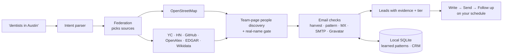

<div align="center">

# 🧲 OpenLeads

### Find people and their work emails from free public data — then work them like you would in Apollo. No API keys. $0.

**Type who you want (_"dentists in Austin"_, _"fintech founders"_, _"law firms in London"_) and OpenLeads searches OpenStreetMap, Y Combinator, GitHub, OpenAlex, SEC EDGAR, Wikidata and company websites, finds the real people, and tells you honestly which emails are confirmed and which are guesses. Then it scores them against your ideal customer, organizes them into lists, and runs multi-step email, call and LinkedIn sequences, tasks and a deal pipeline. It runs on your machine.**

[](./COMMERCIAL-LICENSE.md)
[](https://pypi.org/project/openleads/)
[](https://www.npmjs.com/package/openleads)
[](https://www.python.org/)
[](#how-it-works)
[](https://github.com/Samyrrrrrr990/openleads/actions/workflows/ci.yml)
[](./BENCHMARK.md)
[](https://github.com/Samyrrrrrr990/openleads/stargazers)

```bash
pipx install openleads        # or: pip install openleads   ·   npx openleads
openleads find "dentists in Austin"
openleads web                 # the dashboard · or `openleads demo` to look around first
```

[**Website**](https://samyrrrrrr990.github.io/openleads/) · [**Docs**](https://samyrrrrrr990.github.io/openleads/docs/) · [**Live benchmark**](./BENCHMARK.md) · [**Changelog**](./CHANGELOG.md)


<sub>The local dashboard (<code>openleads demo</code>, invented data). Light and dark, keyboard-first, nothing leaves your machine.</sub>

</div>

---

```text
$ openleads find "dentists in Austin" -n 6
  ◆ federated search · local …
    1  ▌safe   info@example-dental.com        Example Dental        ▰▰▰▰▰▰▰▰▰▰  98% found
    2  ▌safe   hello@smile-example.com        Smile Example Co      ▰▰▰▰▰▰▰▰▰▰  98% found
    3  ▌risky  maria.lopez@smile-example.com  Maria Lopez           ▰▰▰▰▰▰▱▱▱▱  62% guessed
    4  ▌safe   d.kim@ortho-example.com        Daniel Kim            ▰▰▰▰▰▰▰▰▰▱  88% pattern
  ──────────────────────────────────────────────────────
  6 leads   4 safe deliverable   2 risky unconfirmed   ██████████████████░░░░░░
  4 found or built from a seen pattern · 2 guessed
```
<sub>Output shape from a real run; businesses and people renamed.</sub>

## Why it's different

Apollo, Hunter and ZoomInfo sell a contact database and email verification, then
charge again for sending. OpenLeads does all three for free, from public data, on
your laptop. Two things matter most:

**It's honest about every email.** Most free finders label a `first.last@` guess as
"valid". OpenLeads marks each address:

| Evidence | Meaning |
|---|---|
| **found** | Published on the web, or confirmed by the mail server |
| **pattern** | Built from the format a real address at that company uses |
| **guessed** | A common format, unconfirmed. It's labelled, so you decide |

Those feed a send decision: **safe** (send it), **risky** (held back unless you opt in),
**bad** (dropped). Read [how the scoring works](./docs/deliverability.md).

**It's measured against live data every night.** Unit tests can't tell you whether
"dentists in Austin" returns dentists. [`openleads bench`](./BENCHMARK.md) runs 12 real
queries against the live sources and publishes the results:

<!-- BENCH:START -->
| Real query | v4.0 | **v4.5** |
|---|---|---|
| "marketing agencies in Miami" | 6 of 20 "people" were page headings ("Refund Policy") | **0 junk names** |
| "dentists in Austin" | chiropractors and transport companies, 0 usable | **10 dentists** |
| "machine learning researchers" | 0 results | **10 researchers** |
| "rust developers in Berlin" | still running after 4 min | **10 in 5s** |

Latest full run (12 queries, 10 leads each): **12/12 return results · 84% fill ·
0% junk names · 32% of emails found or pattern-backed, the rest labelled guessed ·
54s median.** [Full scoreboard →](./BENCHMARK.md)
<!-- BENCH:END -->

## Apollo, on your laptop

|  | Apollo | **OpenLeads** |
|---|---|---|
| Where contacts come from | A licensed database | Public sources, searched on demand for your exact query |
| Email confidence | A status per address (verified, extrapolated, …) | **found · pattern · guessed** per address, with the reasons |
| People & company search with filters | ✓ | ✓ seniority, department, industry, size, tech stack, location, stage, fit… |
| Lists, tags, notes, saved searches | ✓ | ✓ |
| ICP fit scoring | ✓ | ✓ 0–100 + A–D, with a what-if preview |
| Multi-step sequences (email, call, LinkedIn, tasks) | ✓ | ✓ A/B variants, threading, AI-written steps, auto-stop on reply |
| Task queue · deal pipeline | ✓ | ✓ focus mode · drag-and-drop board with weighted forecast |
| CSV import & export | ✓ | ✓ auto-maps Apollo, HubSpot and LinkedIn exports; exports in Apollo or HubSpot format |
| Use from Claude, Cursor, Claude Code | | ✓ built-in MCP server with read and write workspace tools |
| Where your data lives | Their cloud | **A SQLite file on your machine** |
| Price | Free tier with credit limits; paid per seat | **$0, open source** |

## What you can search

One query fans out across the sources that fit it. You never pick a source, but
`-s name` pins one.

| Ask for | Searched | Example |
|---|---|---|
| Local businesses, any city | OpenStreetMap (Overpass + Nominatim) | `"accountants in Toronto"` |
| Startup founders, companies hiring | Y Combinator, Hacker News | `"AI startup founders"` |
| Companies by industry | Wikidata, SEC EDGAR | `"fintech companies"` |
| Developers | GitHub | `"rust developers in Berlin"` |
| Researchers | OpenAlex | `"machine learning researchers"` |
| Everyone at one company | the company's own site | `"emails at stripe.com"` |
| US healthcare providers | NPI Registry | `"pediatricians"` |

Each company is turned into named people from its team and about pages. Every address
then goes through the email checks: published-address harvest, learned company
pattern, MX/SPF/DMARC, Gravatar, and SMTP where port 25 is open.

Need a source we don't have? A source is [one Python file](./docs/sources.md).

## Work your leads

Everything you find lands in a local **workspace** — the same data in the
dashboard, the terminal and your AI assistant.

<table>
<tr>
<td width="50%"></td>
<td width="50%"></td>
</tr>
<tr>
<td><b>People & companies.</b> Facets with live counts, saved searches, bulk actions on every matching row, full records with timeline, notes, tasks and deals.</td>
<td><b>Sequences.</b> Email, call, LinkedIn and task steps; A/B variants; same-thread follow-ups; AI-written steps; people leave when they reply.</td>
</tr>
<tr>
<td></td>
<td></td>
</tr>
<tr>
<td><b>Deals.</b> A drag-and-drop pipeline with weighted forecast; winning a deal makes the contact a customer.</td>
<td><b>Everything else.</b> Task queue, templates, ICP scoring, CSV import, data health and duplicate merge, a ⌘K palette.</td>
</tr>
</table>

```bash
openleads people --fit A --never-contacted                 # best untouched leads
openleads lists add "Q4 dentists" --where dental
openleads seq enroll "Q4 outbound" --list "Q4 dentists"
openleads tasks --bucket today
openleads import apollo-export.csv --list "Imported"
```

[Workspace guide →](./docs/workspace.md) · [Sequences guide →](./docs/sequences.md)

## Use it from Claude, Cursor or Claude Code

OpenLeads is an [MCP server](./docs/mcp.md). Your AI assistant can find and verify
leads mid-conversation:

```bash
claude mcp add openleads -- openleads mcp
```

```json
{ "mcpServers": { "openleads": { "command": "openleads", "args": ["mcp"] } } }
```

> *"Find 10 law firms in London with emails we can actually send to, and draft a two-line intro for each."*

> *"Save them to a list called London law, add the A-grade ones to my Q4 sequence, and give me a call task for each partner."*

The workspace tools let an assistant search your contacts and companies, read a
full record, and save leads, set stages, tag, take notes, create tasks and deals
and enroll people in sequences — never sending anything itself.

## Build it as a workflow

The dashboard's **Workflows** page draws each saved search as a node canvas, like n8n.

Click a node to edit it (who to find, what to offer, when to run, where to export), then hit
**Test run** and watch every node fill in from the live engine. Test runs never
send. [Workflows guide →](./docs/workflows.md)


Export nodes push leads to CSV, Google Sheets, Notion, Airtable, or any webhook, so
the rest of your stack (n8n, Zapier, Make) can take it from there.

## Put it on a schedule

```bash
openleads recipe add miami "marketing agencies in Miami" --every "weekdays 9am" --send
openleads schedule on     # one agent: launchd · cron · Windows Task Scheduler
openleads runs            # what ran, what it found, what failed
```

Schedules can be plain English (`every 2h`, `mon,thu 14:00`) or cron. Sends stay
inside your daily cap, warmup ramp and business-hour windows, and stop for anyone
who replies. Failed runs send a desktop alert, plus a webhook if you set one.
[Timed runs →](./docs/timed-runs.md)

Rather run it in CI? There's a GitHub Action:

```yaml
- uses: Samyrrrrrr990/openleads@v5.0.0
  with: { query: "marketing agencies in Miami", count: 50 }
```

## Install

```bash
pipx install "openleads[all]"     # recommended
pip install openleads             # minimal: stdlib-only engine + CLI
npx openleads find "…"            # Node: sets up a private Python env on first run
```

```bash
openleads doctor    # checks your setup (DNS, port 25, mailbox)
openleads           # chat: type what you want
openleads web       # local dashboard at http://127.0.0.1:8787
```

Full walkthrough: [docs/quickstart.md](./docs/quickstart.md).

## Commands

```bash
openleads find "50 fintech founders, verified only" -o leads.csv
openleads find "emails at stripe.com"
openleads enrich my-list.csv                   # your names/companies → verified emails
openleads verify ada@acme.io                   # check one address

openleads run "rust developers in Berlin"      # find → write → send (dry-run unless --live)
openleads recipe add NAME "query" --every "…"  # save it, schedule it
openleads watch add NAME "query"               # alert me only on new matches
openleads schedule on | off | status
openleads runs

openleads people · companies · lists · seq       # your workspace (see above)
openleads tasks · deals · import · dedupe · stats
openleads demo                                 # the dashboard on invented data

openleads bench                                # live quality benchmark
openleads mcp                                  # MCP server for AI tools
openleads sources · crm · config · doctor · inbox
```

Sending is a **dry run by default** everywhere. Add `--live` to send.

## How it works



The core is Python standard library only. Everything, including your leads, drafts,
mailbox credentials, learned patterns and your whole workspace (people, companies,
lists, sequences, tasks, deals), lives in `~/.openleads`. There's no
hosted backend, no account and no telemetry. Details: [docs/architecture.md](./docs/architecture.md).

## Responsible use

OpenLeads is for legitimate prospecting, recruiting and research. You're responsible
for anti-spam law (CAN-SPAM, GDPR, CASL) and each source's terms. It ships the
guardrails: dry-run by default, suppression list, one-click unsubscribe, warmup caps,
no tracking pixels. Read [docs/responsible-use.md](./docs/responsible-use.md).

## License

**Open source under [AGPL-3.0](./LICENSE).** Using OpenLeads is free, including at
your company. If you embed it in a closed-source product, or run a modified version
as a service without publishing your changes, you need a
[commercial license](./COMMERCIAL-LICENSE.md). Releases up to 4.0.1 were PolyForm
Noncommercial.

## Contributing

The highest-impact PR is a new source ([guide](./docs/sources.md)). The second is a
query that `openleads bench` scores badly, along with the fix.
See [CONTRIBUTING.md](./CONTRIBUTING.md).

## Thanks

[OpenStreetMap](https://www.openstreetmap.org/copyright) contributors ·
[OpenAlex](https://openalex.org) · [`yc-oss/api`](https://github.com/yc-oss/api) ·
[NPI Registry](https://npiregistry.cms.hhs.gov/) · SEC EDGAR · Wikidata · Gravatar ·
US Social Security Administration (given-name data).

<div align="center">

**If OpenLeads found you a customer, a ⭐ helps other people find it.**

</div>

<!-- mcp-name: io.github.Samyrrrrrr990/openleads -->
